# Infinite City

A science-fiction city of floating blocks in space, built with **Godot 4.7**. Cyberpunk in
blockspace: the city has exactly one border, its roof. Only the uppermost layer sees the light
source above it; everything below lives on neon, lamps and lit windows, deep in a violet fog.
Downward and to every side the city never ends. Canyons and shafts open it up for travel in
every direction, bridges join neighbouring blocks, and you can walk across them into any block:
along its corridors, up its stairs and into flats, shops, farms and offices. Some doors open
into spaces far bigger than the blocks that hold them.

| On a bridge, 21 layers down | Inside: the corridor behind the entrance |
|---|---|
| 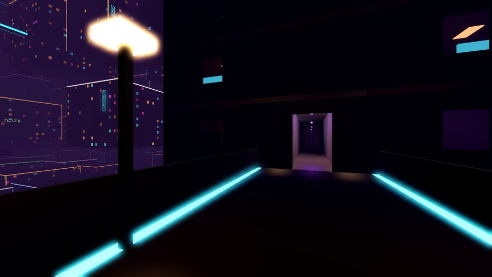 | 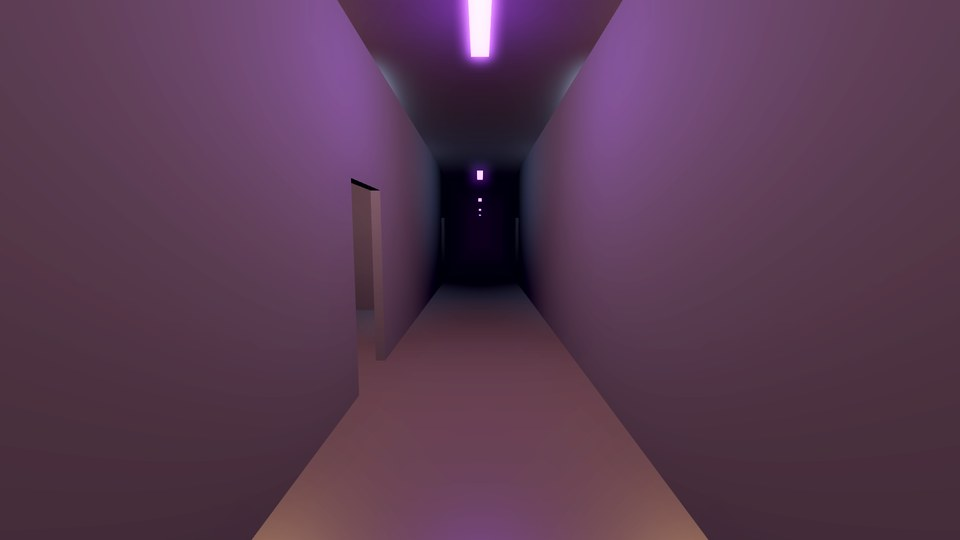 |
| **A flat's living room** | **A shop** |
| 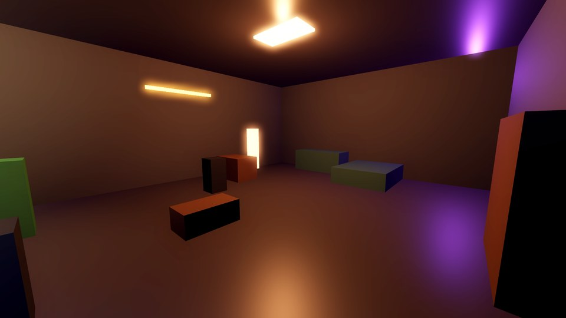 | 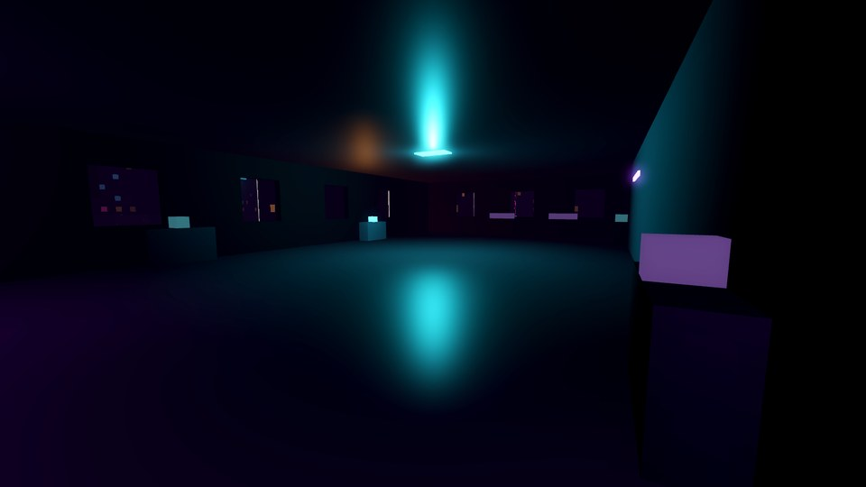 |
| **Out of the window into the canyon** (with the read-out) | **On foot at the start** |
| 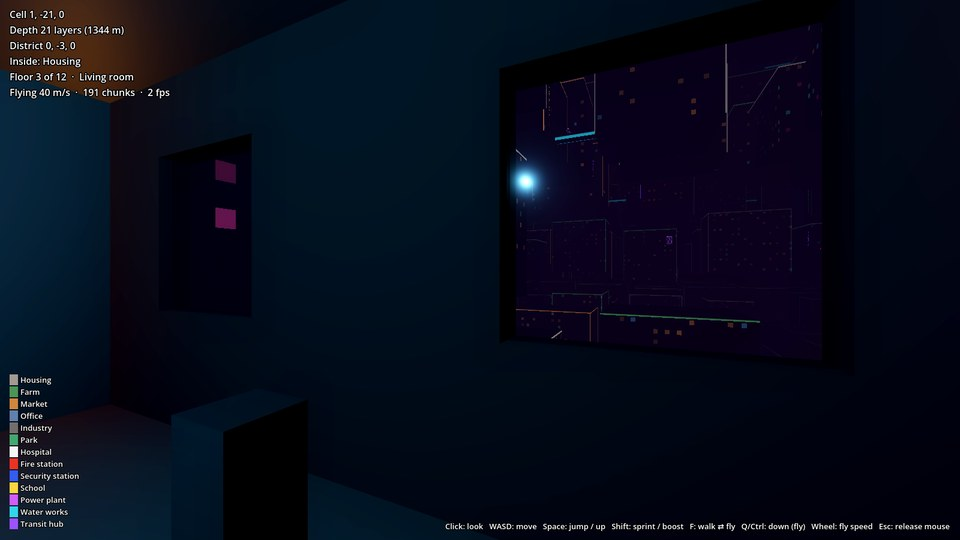 | 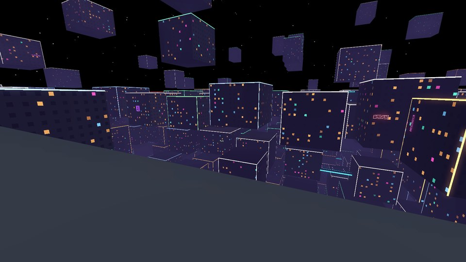 |
| **Above the roof: the only sunlit layer** | **Up a shaft to the light** |
| 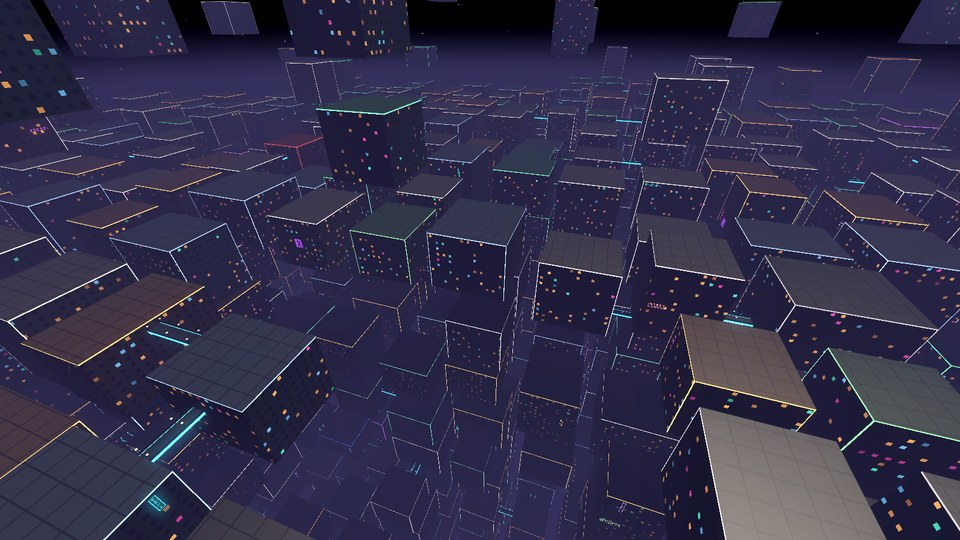 | 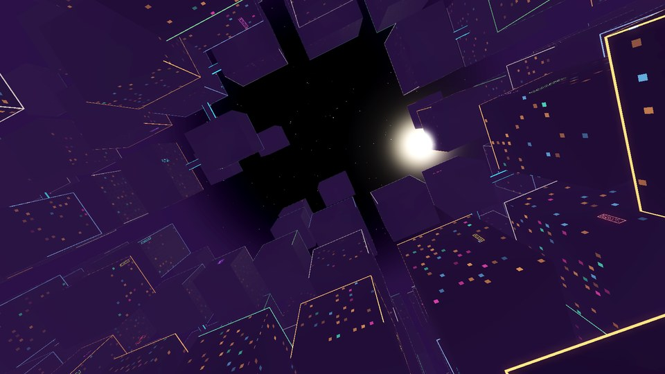 |
| **Inside a canyon, 22 layers down** | **640,000 km down: same precision** |
|  |  |
| **A magic doorway…** | **…opens into a hall hundreds of metres long** |
| 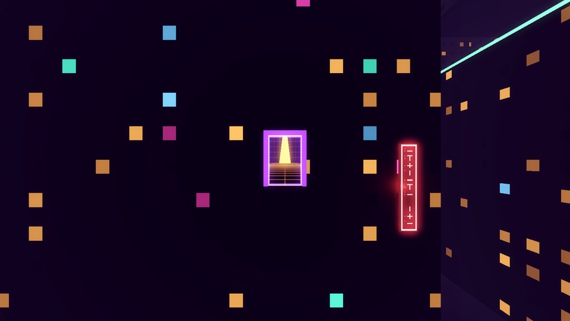 | 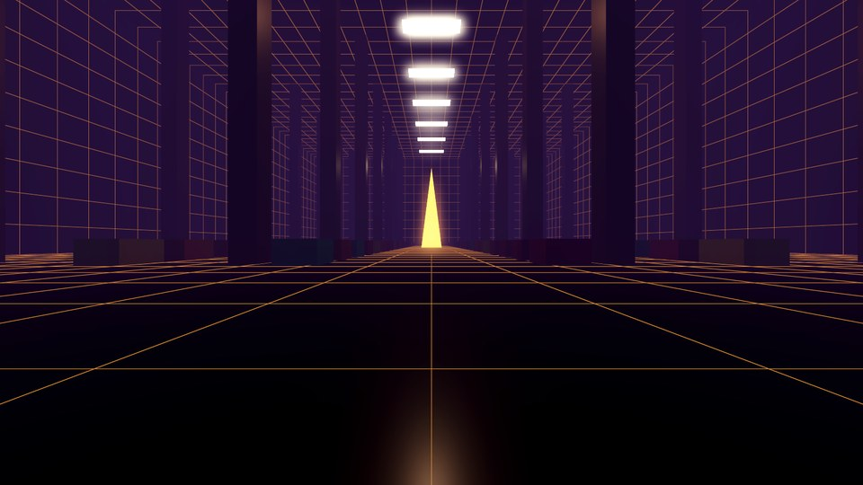 |
| **Looking back out at the city from inside** | |
| 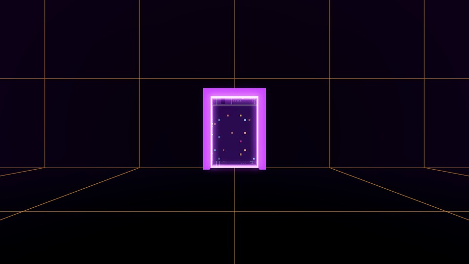 | |

All images are rendered headless by `scripts/screenshot.sh` with software OpenGL (the
Compatibility renderer), so the real game looks crisper.

## Can this be done? Yes, and here is how

### 1. "Terrain" generation for an infinite city

The city is not a heightmap. It is a **3D lattice of 64 m cells**, and every cell answers
"what is here?" as a **pure function of (seed, integer coordinates)**:

- **Deterministic hashing** (MurmurHash3 on 32-bit words, made overflow-safe for GDScript's
  64-bit ints) instead of noise or global random state. Any region can be generated in any
  order, on any machine, with identical results. Golden values are pinned by tests.
- **One border:** above roof layer `R` there are 4 sparse sky layers, thinning upward, and
  nothing beyond them. Below and sideways the lattice covers the full 32-bit coordinate range.
- **Canyons that go on forever** come from integer rules per district (8×8×8 cells), so they
  stay continuous without needing their neighbours. Vertical shafts depend only on the district
  column (x, z), and X/Z canyons depend only on the district row. Plazas add local open space.
- **A real city:** blocks are housing, farms, markets, offices, industry and parks, with a mix
  that changes with depth (farms and industry deep down, markets and offices near the roof).
  Every district has exactly one hospital, fire station, security station, school, power
  plant, water works and transit hub.
- **One floor grid:** block heights are whole 4 m floors and every bridge deck lies on a floor
  and on the line through both cell centres, so every bridge arrives at a corridor.
- **Streaming:** 4×4×4-cell chunks (~2 ms each in GDScript) load nearest first in an ellipsoid
  around the player, with a per-frame budget.
- **Floating origin:** float32 positions lose precision kilometres from the origin. So all scene
  positions are relative to an *integer* origin chunk that follows the player. Precision at
  10 million layers down is the same as at the roof (see the deep screenshot).

### 2. Cyberpunk light: sun on top, neon below

- **Sunlight only on the uppermost layer.** The block, bridge and façade shaders mask the
  directional light by height (it fades out within 16 m below the roof layer) and the light
  dims to nothing as the player descends. Interiors are on their own visual layer the sun
  never reaches.
- **Dark and foggy:** near-zero ambient light, exponential fog that limits sight to a few
  hundred metres below the roof and darkens with depth, filmic tone mapping and bloom.
- **Artificial light:** neon signs on the façades (markets the most, every service in its own
  colour, some flickering), lamps along every bridge, lit windows in a neon-tinted palette, and
  a pool of 12 real lights that follows the player to the nearest signs, lamps and room lights.

### 3. Walk-in interiors for every block

- **A plan for every block,** derived from (seed, cell) like everything else: a corridor cross
  along the cell centre lines reaching all four faces, more corridors in deep blocks, rows of
  units facing the corridors, a switchback stair core from the lowest floor to a hut on the roof,
  entrances where bridges arrive and windows on the façade's 4 m grid.
- **Furnished units:** flats get a bathroom, kitchen, bedroom and living room; shops, offices,
  farms, workshops, gardens, wards, classrooms, fire and security stations, plants and halls get
  their own themed furniture. A furnisher places items against walls or in grids and rejects
  anything that blocks a door. Every room has a ceiling light.
- **Only nearby blocks are built:** within 12 m of the player (at most two), one floor per frame
  (~1.5 ms) starting at the player's floor. Only when every floor exists is the block's sealed
  box swapped for the real shell, so the swap is invisible. Full collision exists only for the
  player's floor and the floors next to it; the outer shell is solid everywhere.
- **Moody rooms:** only the room lights of the player's floor join the light pool, with a soft
  falloff, so rooms are lit in warm, cool or neon tones while the rest of the block stays dark.

### 4. Magic doorways (bigger on the inside)

- **Doorways are transform pairs.** The outer door A sits on a block; the inner door B sits on
  the wall of the pocket space. A pose is carried through with `M = B · R_y(π) · A⁻¹`, so what is
  in front of one door continues behind the other.
- **The interior lives out of sight, 12 km above its door** and is drawn on its own visual
  layer. It can be any size (here 160–320 m wide, 60–140 m high, 240–480 m deep) behind a 4 m
  door on a ~50 m block.
- **Live view:** a second camera in a `SubViewport` takes `M · camera`. The door surface shows
  its image at `SCREEN_UV`. Its near plane is clipped at the far door, so walls in between
  never block the view.
- **Seamless crossing,** flying or on foot: when the player crosses the door plane from the
  front, inside the opening, they are moved through `M` in the same frame, keeping position,
  view direction and speed. Crossing from behind does nothing. The city around the entrance
  stays loaded while you are inside, so stepping out again is instant.

## Running it

1. Install **Godot 4.7.2** (standard build, GDScript only), or run `scripts/install-godot.sh`
   on Linux.
2. Open the project folder in Godot and press **Play**, or run `godot --path .`.

You start on foot on a roof at the rim of a shaft, near the top of the city. **Click** to look
around, **WASD** to walk, **Space** to jump, **Shift** to sprint. Walk along a bridge into any
block, follow the corridor, take the stairs. **F** switches to flying (**Space/E** up,
**Q/Ctrl** down, **Shift** boost, **mouse wheel** changes speed) and back. **Esc** releases the
mouse. Walk or fly through any glowing violet doorway. The read-out at the top left names the
cell, depth, district, and inside a block the floor and the room.

## How it is developed: OpenSpec + test-driven development

Every feature goes through [OpenSpec](https://github.com/Fission-AI/OpenSpec):

1. **Propose:** `openspec/changes/<name>/` gets a proposal, spec deltas (requirements with
   testable scenarios), a design and a task list. Ordered test-first.
2. **Apply:** each scenario becomes a failing [GUT](https://github.com/bitwes/Gut) test, then the
   smallest implementation that passes it.
3. **Archive:** the spec deltas merge into `openspec/specs/`, which always describes what the
   game does today.

Git history follows this rhythm (*Propose → Implement → Archive*) for each change:

| Change | Capabilities (in `openspec/specs/`) |
|---|---|
| `add-city-generation` | `city-layout`, `city-zoning`, `city-bridges` |
| `add-world-streaming` | `world-streaming`, `floating-origin`, `city-rendering`, `free-flight` |
| `add-pocket-doorways` | `pocket-doorways`, `pocket-spaces`, `portal-traversal` |
| `add-cyberpunk-atmosphere` | `city-lighting`, `city-rendering` |
| `add-on-foot-movement` | `on-foot-movement`, `free-flight`, `city-rendering`, `pocket-spaces`, `portal-traversal` |
| `add-block-interiors` | `block-interiors`, `city-layout`, `city-bridges` |

```bash
scripts/install-godot.sh              # once: Godot 4.7.2 into .tools/godot/
scripts/test.sh                       # 259 GUT tests, headless (~90 s)
scripts/test.sh -gselect=interior     # only test files matching "interior"
scripts/screenshot.sh out.jpg --doorway --inside           # headless render (needs Xvfb)
scripts/screenshot.sh out.jpg --interior=flat --pos=100,-1300,60
openspec list --specs                 # current capabilities
openspec validate --all --strict      # spec hygiene (also run in CI)
```

Pure logic lives in `src/core/` (no scene tree, fully unit-tested). Scene nodes live in
`src/world/` (integration-tested, including walking through an entrance and up a flight of
stairs with real physics). GitHub Actions runs the GUT suite and strict OpenSpec validation on
every push. Static typing is enforced, so untyped declarations are parse errors.

## Roadmap (next OpenSpec changes)

1. **`add-teleport-network`**: transit hubs (one per district) linked to neighbouring hubs and
   to express hubs far above and below. Instant jumps with a rebase.
2. **`add-flying-traffic`**: lanes through gaps, canyons and shafts. Cars placed by
   `f(lane, time)`, so traffic is deterministic and only simulated near the player. Their
   headlights and neon underglow would light the canyons.
3. **`add-city-connections`**: long-span bridges across canyons, lifts in the stair cores,
   stairs between layers.
4. **`add-city-life`**: people in corridors and flats, doors that open, interactive objects,
   and services that work: fire stations dispatch, hospitals treat.
5. **Atmosphere:** rain, steam vents, volumetric light shafts from the roof.
6. **Performance:** chunk and interior generation on worker threads, level of detail beyond the
   streaming radius, lower-resolution portal views.
7. **Gameplay:** what the player *does* in the city. A story, jobs, exploration goals. This is
   the big open design question.

## Known limitations of this prototype

- Only the two blocks nearest the player have real interiors; further away the façades show
  painted windows. Entering a block is seamless, but the lit-window pattern changes when a block
  is swapped for its interior.
- Lights cast no shadows, so walls and floors do not block light. That is why only the
  player's floor is lit.
- One live portal at a time. Other doorways shimmer until you are within 160 m.
- Furniture is made of boxes.
