# Infinite City

A science-fiction city of floating blocks in space, built with **Godot 4.7**. Cyberpunk in
blockspace: the city has exactly one border, its roof. Only the uppermost layer sees the light
source above it and stands clear above a sea of fog; everything below lives on neon, lamps and
lit windows, drowned in heavy violet fog.
Downward and to every side the city never ends. Canyons and shafts open it up for travel in
every direction, bridges join neighbouring blocks, and you can walk across them into any block:
along its corridors, up its stairs and into flats, shops, farms and offices. Some doors open
into spaces far bigger than the blocks that hold them.

On top of the city sits **Fogline**, a game about a courier who lives just under the fogline.
Every seed generates centuries of history, factions and gangs, millions of residents with homes,
jobs, routines and relationships, and a plot cast from the people and factions around the start.
You begin with noodle deliveries to real doors and end holding a key every power in the district
wants.

| On a bridge in the fog, 21 layers down | Inside: the corridor behind the entrance |
|---|---|
| 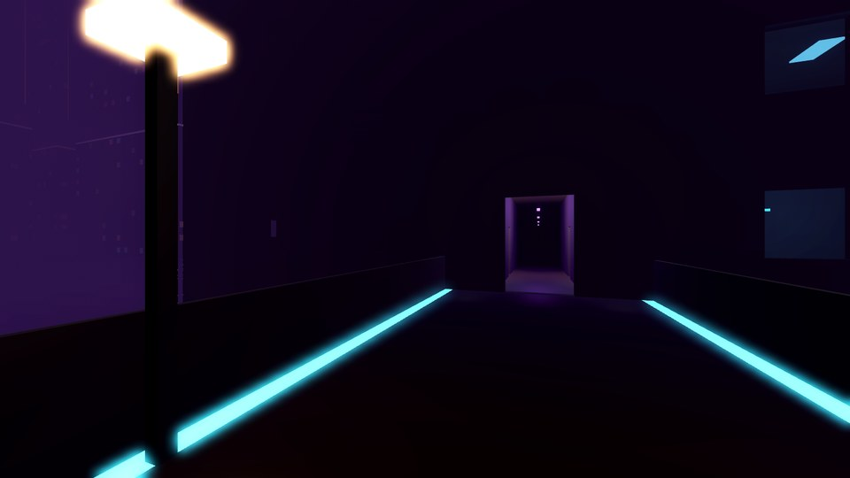 | 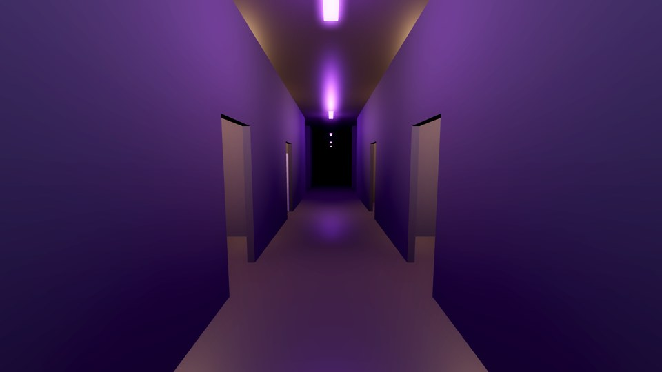 |
| **The stair core** | **A flat's living room** |
| 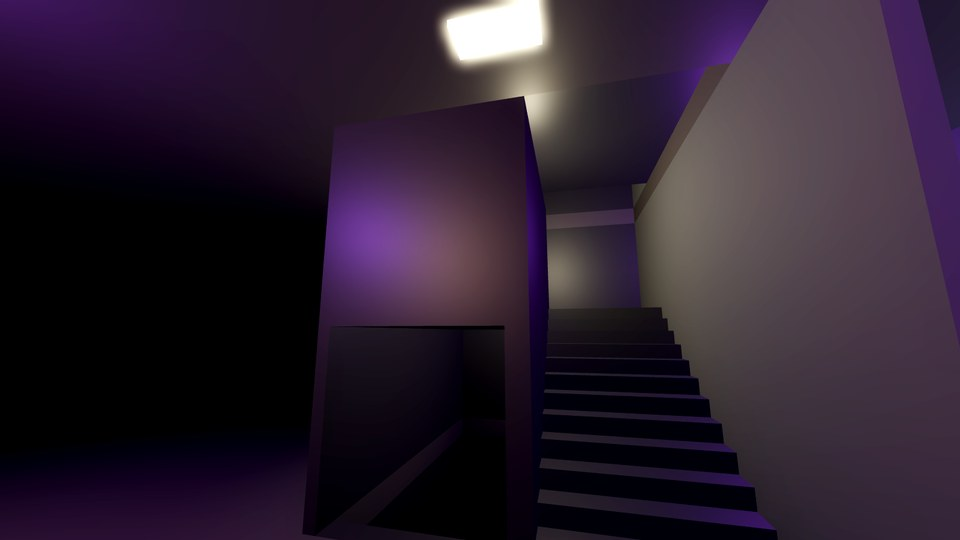 | 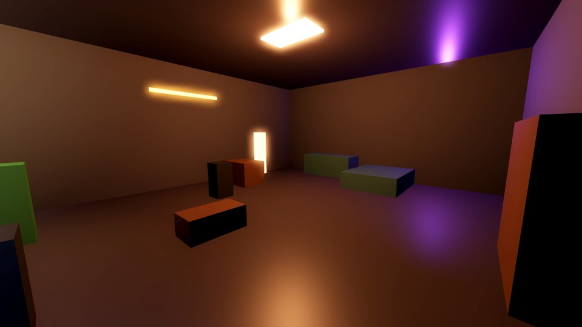 |
| **A shop** | **Out of the window into the fog** (with the read-out) |
| 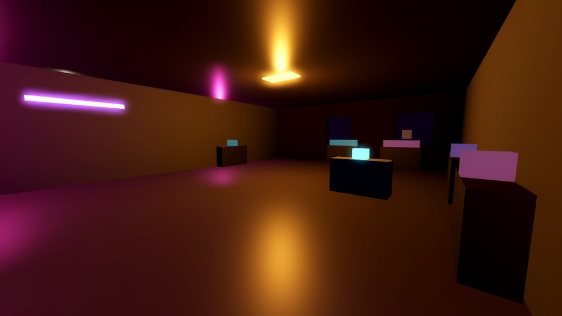 | 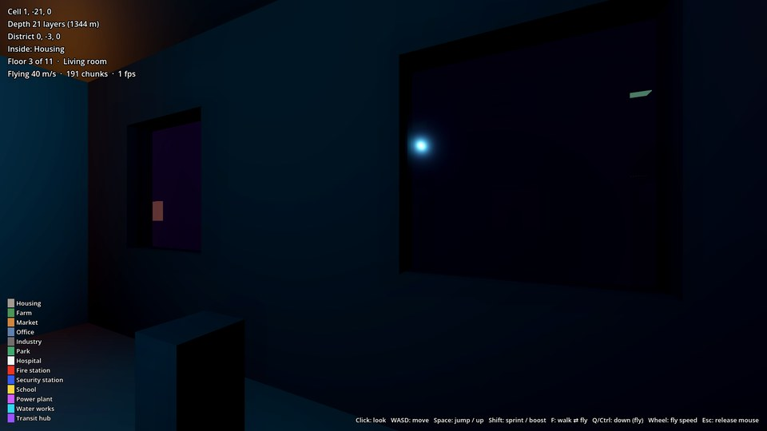 |
| **On foot at the start: sunlit roofs on a sea of fog** | **Above the roof** |
| 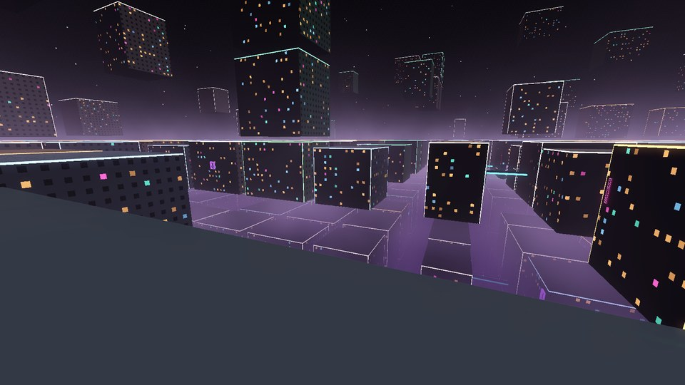 | 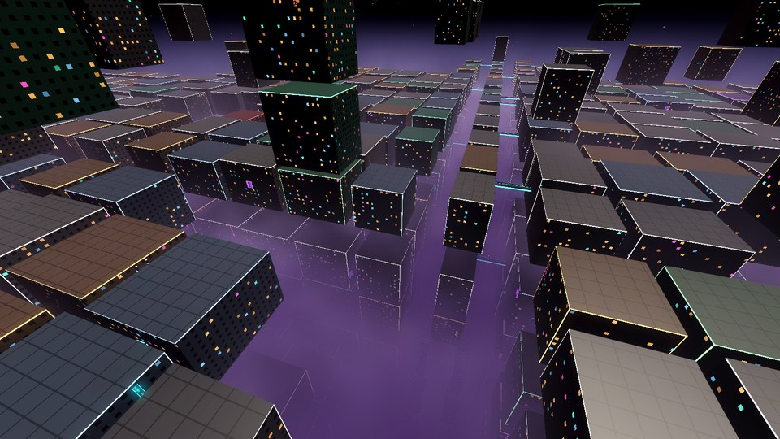 |
| **From the top of the fog sea up to the light** | **Inside a canyon, 22 layers down** |
|  | 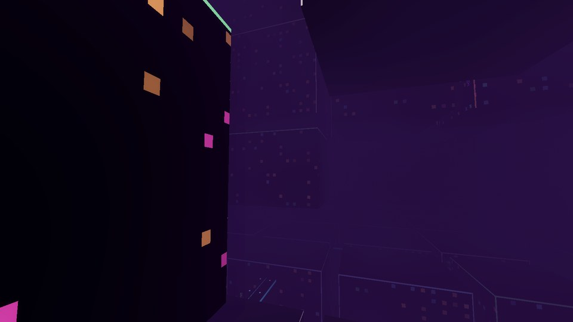 |
| **A major traffic lane: an avenue through the fog** | **A flight level between two layers** |
| 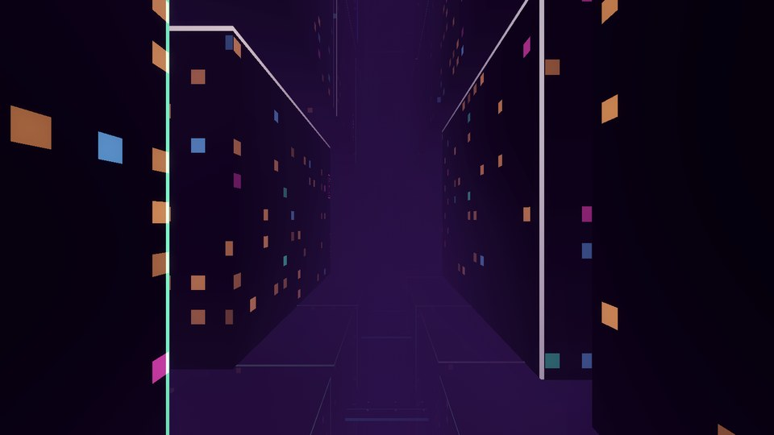 | 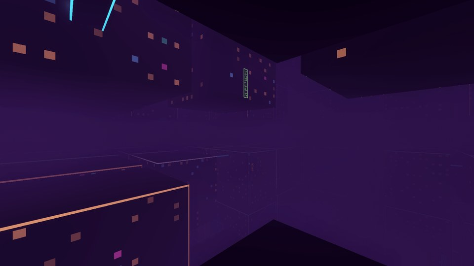 |
| **640,000 km down: same precision** | |
|  | |
| **A magic doorway…** | **…opens into a hall hundreds of metres long** |
| 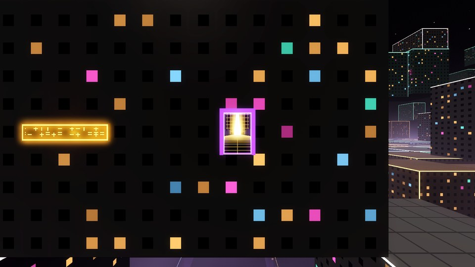 |  |
| **Looking back out at the city from inside** | **The first scene of the story, cast from the city** |
| 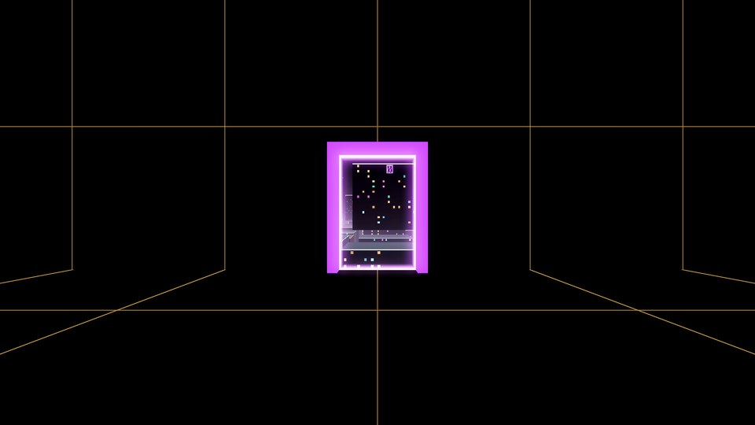 | 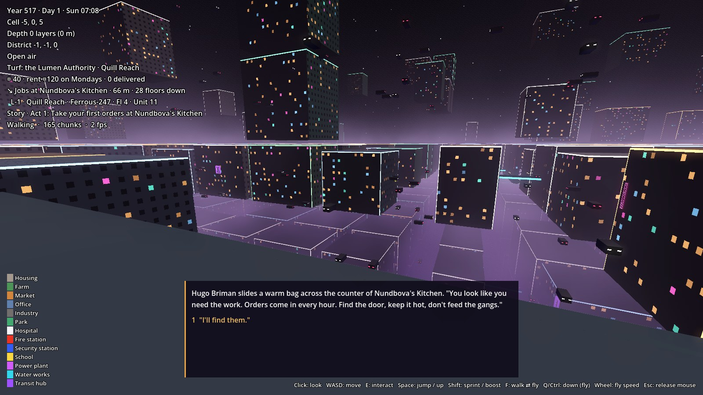 |

All images are rendered headless by `scripts/screenshot.sh` with software OpenGL (the
Compatibility renderer), so the real game looks crisper.

## Can this be done? Yes, and here is how

### 1. "Terrain" generation for an infinite city

The city is not a heightmap. It is a **3D lattice of 64 m cells**, and every cell answers
"what is here?" as a **pure function of (seed, integer coordinates)**:

- **Deterministic hashing** (MurmurHash3 on 32-bit words, made overflow-safe for GDScript's
  64-bit ints) instead of noise or global random state. Any region can be generated in any
  order, on any machine, with identical results. Golden values are pinned by tests.
- **One border:** above roof layer `R` there are 4 sparse sky layers, thinning upward, and
  nothing beyond them. Below and sideways the lattice covers the full 32-bit coordinate range.
- **Canyons that go on forever** come from integer rules per district (8×8×8 cells), so they
  stay continuous without needing their neighbours. Vertical shafts depend only on the district
  column (x, z), and X/Z canyons depend only on the district row. Plazas add local open space.
- **Narrow streets, wide lanes:** blocks are packed tight. Each face sits only 2–6 m back from
  its cell edge, so neighbours are 4–12 m apart, and 90% of cells hold a block. About one cell
  boundary in six per axis is a *major traffic lane*: an endless plane where blocks keep 16–18 m
  back, giving 32–36 m avenues (open up and down) and horizontal flight levels between layers.
  The decision depends only on the seed and the boundary index, so a lane runs straight through
  the whole infinite city.
- **A real city:** blocks are housing, farms, markets, offices, industry and parks, with a mix
  that changes with depth (farms and industry deep down, markets and offices near the roof).
  Every district has exactly one hospital, fire station, security station, school, power
  plant, water works and transit hub.
- **One floor grid:** block heights are whole 4 m floors and every bridge deck lies on a floor
  and on the line through both cell centres, so every bridge arrives at a corridor.
- **Streaming:** 4×4×4-cell chunks (~2 ms each in GDScript) load nearest first in an ellipsoid
  around the player, with a per-frame budget.
- **Floating origin:** float32 positions lose precision kilometres from the origin. So all scene
  positions are relative to an *integer* origin chunk that follows the player. Precision at
  10 million layers down is the same as at the roof (see the deep screenshot).

### 2. Cyberpunk light: sun on top, neon below

- **Sunlight only on the uppermost layer.** The block, bridge and façade shaders mask the
  directional light by height (it fades out within 16 m below the roof layer) and the light
  dims to nothing as the player descends. Interiors are on their own visual layer the sun
  never reaches.
- **Dark:** near-zero ambient light, filmic tone mapping, and bloom wide enough that neon and
  lamps glow into the fog.
- **Artificial light:** neon signs on the façades (markets the most, every service in its own
  colour, some flickering), lamps along every bridge, lit windows in a neon-tinted palette, and
  a pool of 12 real lights that follows the player to the nearest signs, lamps and room lights.

### 3. Heavy fog as a shader

- **A full-screen fog pass:** a quad in front of the camera reads the depth buffer and marches
  12 jittered steps along each view ray, accumulating fog and blending it over the frame. It
  replaces the engine's uniform fog.
- **A fog sea:** density and colour depend on the height of every point along the ray. The sunlit
  roof layer holds only a light haze; from its bottom down there is heavy fog (0.02 per metre and
  more deeper down, so after ~150 m nothing shows through); above the roof it clears within a few
  dozen metres, so the light source and the sky blocks stay visible. The top of the fog sea glows
  in the sunlight; below, it is dark violet.
- **Drifting banks:** two octaves of value noise move with a slow wind. The noise is anchored to
  absolute positions (the floating origin modulo 1024 m, computed exactly in integers), so banks
  do not jump when the origin moves.
- **Clear indoors:** no fog inside entered blocks (the march skips their boxes) or pocket spaces
  (by visual layer); the portal view of the city from inside a pocket is fogged like the city.

### 4. Walk-in interiors for every block

- **A plan for every block,** derived from (seed, cell) like everything else: a corridor cross
  along the cell centre lines reaching all four faces, more corridors in deep blocks, rows of
  units facing the corridors, a switchback stair core from the lowest floor to a hut on the roof,
  entrances where bridges arrive and windows on the façade's 4 m grid.
- **Furnished units:** flats get a bathroom, kitchen, bedroom and living room; shops, offices,
  farms, workshops, gardens, wards, classrooms, fire and security stations, plants and halls get
  their own themed furniture. A furnisher places items against walls or in grids and rejects
  anything that blocks a door. Every room has a ceiling light.
- **Only nearby blocks are built:** within 12 m of the player (at most two), one floor per frame
  (~1.5 ms) starting at the player's floor. Only when every floor exists is the block's sealed
  box swapped for the real shell, so the swap is invisible. Full collision exists only for the
  player's floor and the floors next to it; the outer shell is solid everywhere.
- **No flicker:** floors and stairs sit inside the walls, and a test checks that no two drawn
  boxes of different materials overlap anywhere, so no surfaces fight over the same pixels.
- **Moody rooms:** only the room lights of the player's floor join the light pool, with a soft
  falloff, so rooms are lit in warm, cool or neon tones while the rest of the block stays dark.

### 5. Magic doorways (bigger on the inside)

- **Doorways are transform pairs.** The outer door A sits on a block; the inner door B sits on
  the wall of the pocket space. A pose is carried through with `M = B · R_y(π) · A⁻¹`, so what is
  in front of one door continues behind the other.
- **The interior lives out of sight, 12 km above its door** and is drawn on its own visual
  layer. It can be any size (here 160–320 m wide, 60–140 m high, 240–480 m deep) behind a 4 m
  door on a ~50 m block.
- **Live view:** a second camera in a `SubViewport` takes `M · camera`. The door surface shows
  its image at `SCREEN_UV`. Its near plane is clipped at the far door, so walls in between
  never block the view.
- **Seamless crossing,** flying or on foot: when the player crosses the door plane from the
  front, inside the opening, they are moved through `M` in the same frame, keeping position,
  view direction and speed. Crossing from behind does nothing. The city around the entrance
  stays loaded while you are inside, so stepping out again is instant.

## Running it

1. Install **Godot 4.7.2** (standard build, GDScript only), or run `scripts/install-godot.sh`
   on Linux.
2. Open the project folder in Godot and press **Play**, or run `godot --path .`.

A menu asks for your courier's name and pronouns (Esc brings it back). You start on foot on a
roof near the top of the city, near your patron's food counter. **Click** to look around,
**WASD** to walk, **Space** to jump (hold it while falling once you own a glider), **Shift** to
sprint. **F** switches to flying (**Space** up, **Q/Ctrl** down, **Shift** boost, **wheel**
speed). The read-out at the top left names the time, place, turf, your wallet, the next door to
go to and the story's current objective.

### Playing Fogline

- **Deliveries:** press **E** at your patron's door to take an order (up to three), find the
  customer's door by its address and the arrow, press **E** there to deliver. Food cools, so tips
  shrink. Rent is due every Monday.
- **The city lives:** residents keep routines (home, commute, shifts, evenings out) and walk the
  corridors; gangs hold bridges and ask for tolls (**1** pay, **2** talk, **3** run, then lose
  them in the fog); flying cars fill the major lanes; a fall or a car calls the rescue drone,
  which costs ¤25 and the cargo.
- **The story:** a plot template (*The Hidden Abundance*, *The Election* or *The Plague*) is
  chosen for the seed and cast from the people and factions around you. Scenes open on
  deliveries; pick choices with **1–3**. Endings change the district for good.
- **Growing:** standing with the Couriers' Mutual and each gang, licences that unlock better
  cargo, and a shop (**U**): scanner (**R**), flares (**X**), glider and grapple (**G**).
  **M** opens the address book.
- **The world remembers:** districts you know tick daily (gangs take bridges, prices follow the
  blight, people die and move, now and then a district goes dark) into an event log. **F5**
  saves, **F9** loads, the menu keeps named slots, and sleeping at your own door saves too.
- **At the door:** whoever is home answers (or a flatmate, or nobody), and the tip follows. Press
  **E** on anyone in the corridors to hear some gossip; story people are met where their day puts
  them.
- **Finding the way:** small lights mark the next 30 m of the route (**H** toggles them, **J**
  avoids gang bridges). **L** switches your lamp on; it recharges at your patron's counter.
- **Dangers:** gangs on their bridges, Authority checkpoints at the fogline (permits, bribes for
  contraband, or light rights from the shop), rival couriers who take orders left waiting, and
  passengers to escort with a gold licence.
- **Getting around:** every district has a transit hub (**E** at its platform door) linked to its
  neighbours and to express hubs; tall blocks have lifts in the stair core.
- **More stories:** six main plots and three side stories for regulars. **F4** shows session stats.

## How it is developed: OpenSpec + test-driven development

Every feature goes through [OpenSpec](https://github.com/Fission-AI/OpenSpec):

1. **Propose:** `openspec/changes/<name>/` gets a proposal, spec deltas (requirements with
   testable scenarios), a design and a task list. Ordered test-first.
2. **Apply:** each scenario becomes a failing [GUT](https://github.com/bitwes/Gut) test, then the
   smallest implementation that passes it.
3. **Archive:** the spec deltas merge into `openspec/specs/`, which always describes what the
   game does today.

Git history follows this rhythm (*Propose → Implement → Archive*) for each change:

| Change | Capabilities (in `openspec/specs/`) |
|---|---|
| `add-city-generation` | `city-layout`, `city-zoning`, `city-bridges` |
| `add-world-streaming` | `world-streaming`, `floating-origin`, `city-rendering`, `free-flight` |
| `add-pocket-doorways` | `pocket-doorways`, `pocket-spaces`, `portal-traversal` |
| `add-cyberpunk-atmosphere` | `city-lighting`, `city-rendering` |
| `add-on-foot-movement` | `on-foot-movement`, `free-flight`, `city-rendering`, `pocket-spaces`, `portal-traversal` |
| `add-block-interiors` | `block-interiors`, `city-layout`, `city-bridges` |
| `fit-interiors-inside-walls` | `block-interiors` |
| `add-heavy-fog` | `city-fog`, `city-rendering` |
| `add-streets-and-lanes` | `city-layout` |
| M0 `add-game-foundations` | `game-time`, `interaction`, `save-games`, `content-data` |
| M1 `add-city-history`, `add-faction-traces` | `city-history`, `faction-traces` |
| M2 `add-residents`, `add-workplaces` | `residents`, `workplaces` |
| M3 `add-relations` | `relations` |
| M4 `add-courier-jobs` | `addresses`, `courier-jobs` |
| M5 `add-city-navigation`, `add-routines`, `add-people-in-the-city` | `city-navigation`, `routines`, `people-in-the-city` |
| M6 `add-gang-turf`, `add-traffic-and-hazards` | `gang-turf`, `encounters`, `flying-traffic`, `hazards` |
| M7 `add-story-director` | `story-director`, `dialogue` |
| M8 `add-courier-progression`, `add-traversal-tools` | `courier-progression`, `traversal-tools` |
| M9 `add-event-log`, `add-live-simulation` | `event-log`, `save-games`, `live-simulation` |
| M10 `add-plot-acts-3-to-5`, `add-plot-templates`, `add-game-menus` | `story-director`, `game-menus` |
| M11 `add-economy-tables`, `add-first-night-guide` | `economy-tables`, `first-night-guide` |
| M12 `split-courier-state`, `add-hud-panels`, `speed-up-tests` | `courier-state`, `hud-panels`, `test-suite`, `save-games` |
| M13 `add-doorsteps`, `add-meetings`, `add-figure-animation` | `doorsteps`, `story-director`, `people-in-the-city` |
| M14 `add-route-hints`, `add-gang-aware-routes` | `wayfinding` |
| M15 `add-checkpoints`, `add-blackouts`, `add-escorts`, `add-rival-couriers` | `checkpoints`, `blackouts`, `escorts`, `rival-couriers` |
| M16 `add-transit-hubs`, `add-lifts-and-spans` | `transit` |
| M17 `add-plot-templates-2`, `add-side-arcs` | `story-director` |
| M18 `add-export-builds`, `add-accessibility`, `add-music-and-sound`, `add-save-slots` | `release-candidate` |

```bash
scripts/install-godot.sh              # once: Godot 4.7.2 into .tools/godot/
scripts/test.sh                       # ~480 GUT tests, headless (unit and integration in two processes, ~6.5 min)
scripts/install-export-templates.sh   # once: Godot's export templates (1.3 GB download)
scripts/export.sh Linux               # release build into build/ (Linux, Windows, macOS)
scripts/godot.sh --headless --path . -s res://tools/balance_report.gd   # what a day of deliveries earns
scripts/test.sh -gselect=interior     # only test files matching "interior"
scripts/screenshot.sh out.jpg --doorway --inside           # headless render (needs Xvfb)
scripts/screenshot.sh out.jpg --interior=flat --pos=100,-1300,60
openspec list --specs                 # current capabilities
openspec validate --all --strict      # spec hygiene (also run in CI)
```

Pure logic lives in `src/core/` (no scene tree, fully unit-tested). Scene nodes live in
`src/world/` (integration-tested, including walking through an entrance and up a flight of
stairs with real physics). GitHub Actions runs the GUT suite and strict OpenSpec validation on
every push. Static typing is enforced, so untyped declarations are parse errors.

## Roadmap

Draft 2 of the plan (M11–M18) is implemented. What is still open:

1. **Playtests:** the ten human sessions of M11 and the slice checks (an evening of deliveries;
   two playthroughs that differ) still need people. `docs/playtest-sheet.md` is the sheet.
2. **Long spans** across canyons need openings in block walls and new bridge geometry.
3. **Routes across districts** through transit hubs for the hints and the figures.
4. **Recorded sound and music**, code-signed macOS builds.
5. **Speed:** the suite takes about 6.5 minutes (target was 3); chunk and interior generation on
   worker threads.

## Known limitations of this prototype

- Only the two blocks nearest the player have real interiors; further away the façades show
  painted windows. Entering a block is seamless, but the lit-window pattern changes when a block
  is swapped for its interior.
- Lights cast no shadows, so walls and floors do not block light. That is why only the
  player's floor is lit.
- Lamps and signs do not light the fog itself; their halos come from bloom.
- One live portal at a time. Other doorways shimmer until you are within 160 m.
- Furniture is made of boxes, and people are capsules that glide without walking animations.
- A district's job market takes about a second to build on a worker thread; until then its
  workers and routines are not shown.
- Figures are simple capsules with swinging legs; there is no recorded sound.
- The release builds are not code-signed; the macOS build needs a right-click → Open.
